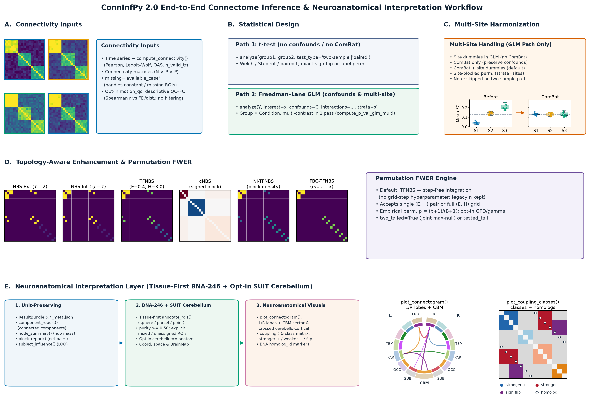
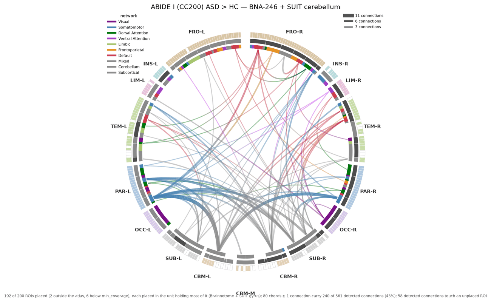
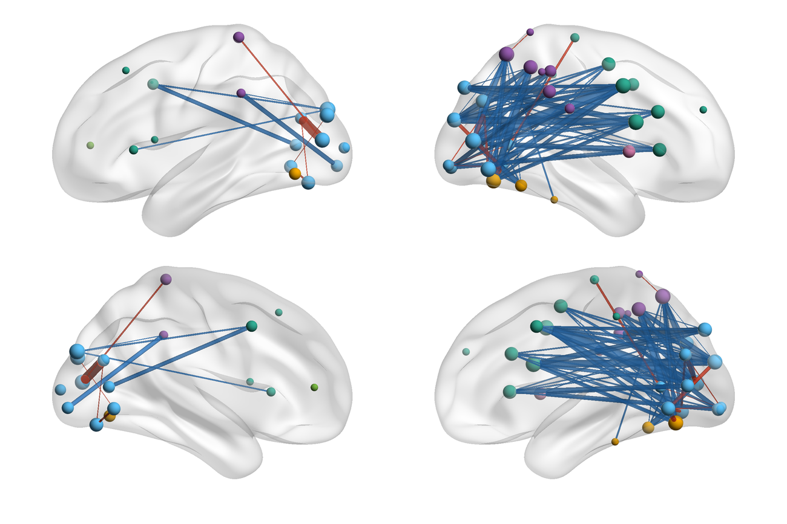
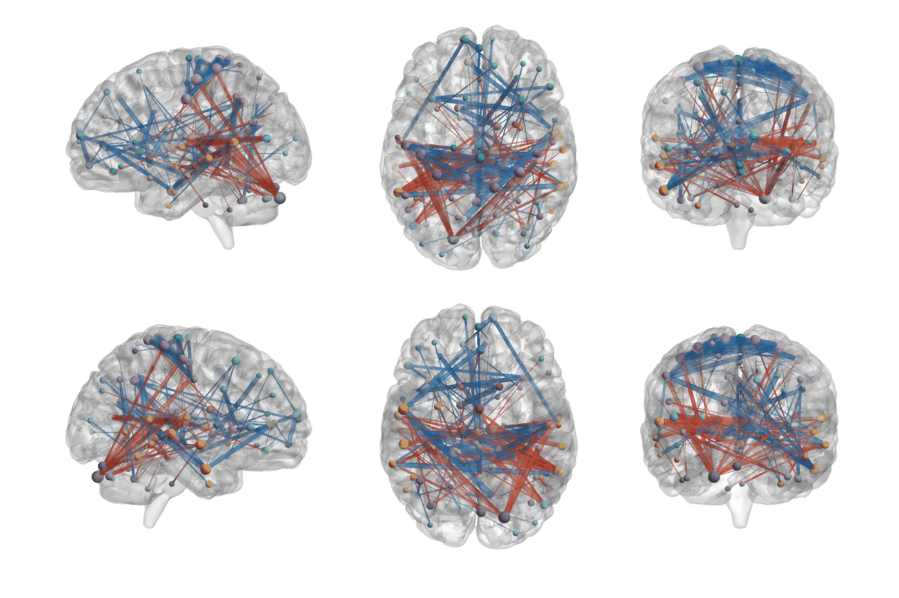
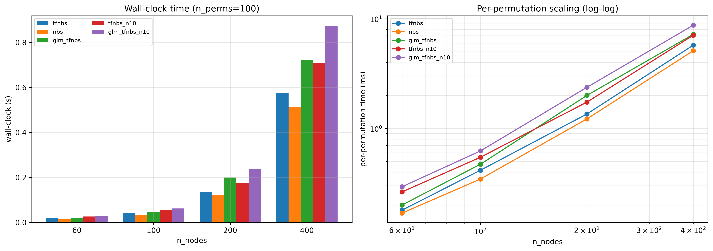

# ConnInfPy — Connectivity Inference in Python

[](https://github.com/IHB-IBR-department/ConnInfPy/actions/workflows/tests.yml)
[](https://ihb-ibr-department.github.io/ConnInfPy/)


**Permutation-based statistical inference on brain connectivity networks (fMRI).**

Start with one connectivity matrix per subject or BOLD time series and a study
design. `conninfpy.analyze()` prepares the input, optionally harmonizes sites,
and returns corrected p-values by direction, with edge, component or block
inference and descriptive anatomical reports.

- **Study designs** — two groups, paired conditions, Group × Condition,
  continuous/categorical predictors, confounds and interactions; edge-wise GLM
  with Freedman–Lane permutations and $t$/$\beta$/F contrasts.
- **Nine inference methods** — TFNBS, NBS (extent/intensity), cNBS, NI-TFNBS,
  FBC-TFNBS, max-$t$, parametric Bonferroni/BH-FDR, and permutation-calibrated
  BH-FDR. [Methods and assumptions](#inference-methods).
- **Multi-site analysis** — NumPy empirical-Bayes ComBat (Johnson 2007;
  Fortin 2017/2018), site indicators and permutations within sites.
- **Diagnostics** — pre-inference motion / QC–FC, leave-one-out subject
  influence, connectivity estimation with shrinkage diagnostics, and edge,
  node, network and component tables. [Results](#results).
- **Anatomical interpretation** — Brainnetome ROI overlap, hemispheric and
  circuit relations, distance, population structural connectivity and BrainMap
  literature context. [Atlases and interpretation](#atlases-and-interpretation).
- **Computation and validation** — Numba-compiled TFNBS/NBS with fallback
  implementations, optional exploratory GPD/gamma tail fits, and 20 planted-effect
  topologies (hub, rich club, chain, gradient, …) for benchmarking.



| ABIDE I (CC200) ASD > HC connectogram (BNA-246 + SUIT) | Open-Close IHB EC vs EO (ICBM152, top-150 \|t\|) | ABIDE I (CC200) ASD vs HC (Ch2withCerebellum, top-150 \|t\|) |
|---|---|---|
|  |  |  |

*Example outputs from `conninfpy interpret --cerebellum anatom --export-brainnet --brainnet-render` (nodes colored by BNA-246 anatomical lobe, edges by effect sign). See [workflows.rst](docs/source/workflows.rst) for Python API examples and color legends.*

## Installation

Requires **Python 3.12–3.14** (`>=3.12,<3.15`). If your system uses Python
3.10/3.11 (e.g. Ubuntu 22.04 LTS or an older conda base), create a Python
3.13 environment using either recipe below.

> **Shared / read-only HPC environments.** If `site-packages` is read-only on a cluster, set a writable Numba cache directory before running ConnInfPy: `export NUMBA_CACHE_DIR=/tmp/numba_cache` (or a writable scratch directory).

### `uv`

[`uv`](https://docs.astral.sh/uv/) manages Python and dependencies.

```bash
# Editable install from a local clone
git clone https://github.com/IHB-IBR-department/ConnInfPy.git
cd ConnInfPy
uv venv --python 3.13
uv pip install -e .

# Or install a built wheel directly / run the CLI + Streamlit app isolated
uv pip install conninfpy-2.0-py3-none-any.whl
uv tool install "conninfpy[app]"
uvx conninfpy info
```

### `conda` / `pip`

```bash
git clone https://github.com/IHB-IBR-department/ConnInfPy.git
cd ConnInfPy
conda create -n conninfpy python=3.13 -y
conda activate conninfpy
python -m pip install -e .
```

PyPI installation, once published, uses `uv pip install conninfpy` or
`python -m pip install conninfpy`. Optional extras include `[app]` (Streamlit
interface), `[notebooks]` (Jupyter tutorials), `[dev]` (tests and docs).

`python -m build` creates `dist/conninfpy-2.0-py3-none-any.whl` and
`dist/conninfpy-2.0.tar.gz`. Install either with `python -m pip install <path>`.
Both include Brainnetome/SUIT atlas data, the Streamlit app and the `conninfpy`
command. Dependencies are resolved on installation; a checkout is then optional.

<details>
<summary>Running without Numba</summary>

Install dependencies manually to use the fallback implementations.

| Scoring path | Backend without Numba |
|---|---|
| Exact TFNBS (`n=None`) | Pure-Python graph and block sweeps |
| Exact NI-TFNBS / FBC-TFNBS | Vectorized NumPy |
| Threshold-grid integration (explicit `n`) and NBS | SciPy |

Each call logs its fallback backend, e.g.
`Numba is not installed; TFNBS (exact) is running on the 'python' fallback backend.`
`conninfpy info` reports Numba availability. Backend choice preserves
permutations, correction and significance level; fallback runtimes are unbenchmarked.

```bash
python -m pip install -e . --no-deps
python -m pip install numpy scipy statsmodels pandas matplotlib scikit-learn joblib threadpoolctl pyyaml "nibabel>=3.2"
```

`nibabel` is required for atlas label images and anatomical annotation.

</details>

## Quick test

### Verify the installation

```bash
conninfpy info          # Python, Numba backend, CPU cores, bundled atlas paths
conninfpy selftest      # synthetic 20-node TFNBS, multiprocessing, bundled atlases
```

This synthetic example uses the core install and takes a few seconds, plus
Numba compilation on first run.

<!-- readme-quickstart -->
```python
import conninfpy

# Two groups of 30 subjects, 40 regions in 4 modules. Group 2 has stronger
# connectivity inside one module ("within_module_dense", one of 20 scenarios).
gen = conninfpy.sim.TopologyDatasetGenerator(n_nodes=40, n_modules=4, seed=0)
ds = gen.generate("within_module_dense", effect_size=0.3, n_samples=30, time_points=200)

out = conninfpy.analyze(
    group1=ds.group1, group2=ds.group2, input="r", test_type="two-sample",
    method="tfnbs", n_permutations=1000, rng=0,   # exact TFNBS integration, empirical permutation p-values (the defaults)
)
print(out)

# Score the result against the planted effect
found = out["positive"] < 0.05
planted = ds.effect_mask != 0
print(f"planted edges found: {(found & planted).sum() // 2} of {planted.sum() // 2}")
print(f"false positives:     {(found & ~planted).sum() // 2}")
```

```text
AnalyzeResult(inference=InferenceResult(method='tfnbs', n_perms=1000, accel=empirical, sig@α=0.05: pos=45, neg=0, wall_time=5.50s))
planted edges found: 45 of 45
false positives:     0
```

`out["positive"]` contains edge-level FWER-corrected TFNBS p-values for
`group2 > group1`, subject to the permutation assumptions; `out["negative"]`
covers the reverse. `input="r"` applies Fisher r→z once. A unit diagonal enables
automatic correlation detection; ambiguous input raises an error.
`out.significant_edges(atlas)` produces an [edge table](#results).

### Try ABIDE-mini from a repository clone

ABIDE-mini contains 204 subjects, Schaefer-100 ROIs and 5 sites. Its manifest
drops one subject with a region without signal. This age GLM adjusts for sex,
motion and site.

<!-- readme-real-data -->
```python
import conninfpy

data = conninfpy.load("datasets/abide_mini.yaml")
pheno = data.pheno
out = conninfpy.analyze(
    data.data,                                     # correlations, detected automatically
    interest=pheno["Age"].to_numpy(float),
    confounds=pheno[["Sex", "Motion_FD"]].to_numpy(float),
    sites=pheno["site"].to_numpy(),                # ComBat + site dummies + site-blocked permutation
    method="tfnbs", n_permutations=1000, rng=0,
)
print(out)
print(out.significant_edges(conninfpy.AtlasInfo.schaefer_100_yeo7()))
```

Permutations run on all CPU cores by default (`use_mp=True`), in scripts and
notebooks alike — no `if __name__ == "__main__":` guard is needed.

To test the CLI and the fMRIPrep workflow on demo data:

```bash
# CLI on bundled ABIDE-mini (also available: datasets/nbs_schizophrenia.yaml, datasets/open_close.yaml)
conninfpy run examples/abide/configs/abide_mini_age.yaml --dry-run
conninfpy run examples/abide/configs/abide_mini_age.yaml --n-jobs 4 --seed 0

# Offline fMRIPrep smoke test (tiny synthetic BIDS derivatives; no download)
python examples/fmriprep_nilearn/run_fmriprep_workflow.py --synthetic --n-permutations 10

# Optional: live nilearn download (12 subjects development fMRI + Schaefer-100; requires [app] / nilearn)
python examples/fmriprep_nilearn/run_fmriprep_workflow.py --n-subjects 12 --atlas schaefer100 --n-permutations 100
```

## Your own data

### Python API

Pass an `(n_subjects, N, N)` stack to `analyze()`, or estimate connectivity
from ROI time series with `compute_connectivity()`. `conninfpy.load()` reads
NumPy arrays, CSV/TSV matrix or time-series directories, NIfTI directories and
fMRIPrep derivatives through a v1 YAML manifest. [Custom atlas constructors](#atlases-and-interpretation)
accept CSV, NIfTI, coordinates and nilearn atlases.

### Command line

Run the full workflow on your own folder without writing Python:

```bash
# 1. Auto-detect your folder (matrices, time series, or bids/derivatives/fmriprep) and build a manifest
conninfpy init-manifest --data-dir /path/to/data_or_fmriprep --pheno /path/to/participants.tsv --out manifest.yaml

# 2. Generate an analysis config and run pre-inference design & motion QC
conninfpy init --manifest manifest.yaml --out analysis.yaml
conninfpy qc analysis.yaml --motion-qc                # alias: conninfpy check

# 3. Preview, run permutation inference, and export anatomical interpretation or subject influence
conninfpy run analysis.yaml --dry-run
conninfpy run analysis.yaml --n-jobs 4 --seed 0
conninfpy interpret conninfpy_results --cerebellum anatom --support sphere --radius-mm 6 --format png --dpi 300
conninfpy influence conninfpy_results --config analysis.yaml --edges "0:1,2:5"
```

Adapt the [fMRIPrep manifest template](examples/fmriprep_nilearn/manifest_template.yaml)
and [ABIDE analysis YAML](examples/abide/configs/abide_mini_age.yaml).
CLI designs include `glm`, `two-sample`, `paired` (with Group × Condition and
interactions) and `one-sample`. `provenance.json` records the package version,
analysis configuration, data and warnings.

### Streamlit app

The app provides manifest loading, design setup, background inference,
directional plots, atlas-aware edge exports and offline Brainnetome annotation.

```bash
uv pip install "conninfpy[app]"   # or: python -m pip install -r requirements/gui.txt
conninfpy app                    # or: streamlit run apps/streamlit_app.py from a clone
```

Under **Dataset Manifest (data.yaml)**, use **Build / inspect manifest from a data
folder** to check an fMRIPrep, connectivity, or time-series directory for
missing files and generate `manifest.yaml`; use **Custom atlas** in the sidebar
to load a custom ROI CSV or 3D integer NIfTI mask. The **Brainnetome Annotation**
step exports descriptive tables, an evidence packet and connectograms offline.
The repository-root `requirements.txt` mirrors `requirements/gui.txt` for
Streamlit Cloud, which reads dependency files beside the entry point or at
the repository root.

## Choosing the design

| Design | Call |
|---|---|
| Two groups | `analyze(group1=A, group2=B, test_type="two-sample")` |
| Two conditions, same subjects | `analyze(group1=A, group2=B, test_type="paired")` |
| … with a confound that differs between conditions (e.g. motion) | add `confounds_group1=fd_A, confounds_group2=fd_B` |
| One group vs zero | `analyze(group1=Y, test_type="one-sample")` |
| Continuous predictor + confounds | `analyze(Y, interest=age, confounds=np.column_stack([sex, fd]))` |
| Several predictors, one permutation pass | `analyze(Y, interest={"age": age, "sex": sex}, confounds=fd)` |
| Multi-site | add `sites=site` (default `harmonize="auto"`; see below) |
| Omnibus F-test, custom contrast | `conninfpy.stats.compute_p_val_glm(Y, design_matrix=X, contrast=C, stat_type="fstat")` |

**Direction.** `positive` is `group2 > group1` for group designs, and a
positive association with `interest` for the GLM.

With `sites=`, permutations are blocked by site. `harmonize=` selects
`"combat_site_dummies_glm"` (ComBat that preserves the confounds but never
sees the tested variable, then site dummies in the GLM — the default when
confounds are given), `"combat_only"`, or `"site_dummies_glm"` (no ComBat).
See the [workflows guide](https://IHB-IBR-department.github.io/ConnInfPy/workflows.html)
for when to use which.

## Inference methods

Pass `method=` to `analyze()` (or to the advanced pipelines):

| `method` | What it does | Extra arguments |
|---|---|---|
| `"tstat"` | Per-edge $t$, max-statistic FWER | — |
| `"tfnbs"` | Threshold-free network-based statistic | `e`, `h`, `n`, `start_thres` |
| `"nbs"` | Fixed-threshold NBS, extent or intensity; component inference | `threshold`, `nbs_stat` |
| `"cnbs"` | Constrained NBS, mean signed t and null per block; Bonferroni FWER or BH FDR across blocks (Noble & Scheinost, 2020) | `net_labels` |
| `"ni_tfnbs"` | Network-informed TFNBS (soft block prior) | `net_labels` |
| `"fbc_tfnbs"` | Functional-block-constrained TFNBS | `net_labels`, `min_cluster_size` |
| `"bonferroni"` / `"bh_fdr"` | Parametric baselines, no permutation | — |
| `"bh_fdr_perm"` | Permutation-calibrated BH-FDR | — |

Shared numerical defaults (`conninfpy.defaults`):
1000 permutations with empirical permutation p-values (`acceleration=None`), exact
TFNBS integration (`n=None`) with `e=0.4`, `h=3.0`, `start_thres=1.65`
(asymptotic normal reference; NBS `threshold=2.0`, `nbs_stat="extent"`;
FBC-TFNBS `min_cluster_size=3`). `analyze()` uses a single two-sided family
(`two_tailed=True`) by default, while the low-level `compute_p_val*`
functions default to `two_tailed=False` (separate one-sided families).

The max-statistic methods (`tstat`, `tfnbs`, `ni_tfnbs`, `fbc_tfnbs`, `nbs`)
share the permutation engine and empirical +1 Phipson–Smyth p-values. FWER
depends on the permutation scheme and method assumptions. Freedman–Lane GLM
inference is approximate. cNBS controls error across blocks; `bh_fdr_perm`
uses a separate permutation-calibrated FDR path. NI-TFNBS uses a soft
block-density prior; FBC-TFNBS uses a hard block prior with minimum cluster
size. Both require a justified, prespecified network partition. See the
[approach guide](https://IHB-IBR-department.github.io/ConnInfPy/approach.html)
for assumptions and calibration limits.

<details>
<summary>Exploratory GPD/gamma tail acceleration</summary>

`n_permutations=200, acceleration="gpd"` (or `"gamma"`) enables fitted-tail
estimates for exploratory runs with a few hundred permutations. Eligible
p-values with fewer than 10 permutation exceedances receive fitted estimates;
the others retain empirical values. GPD additionally requires a unit at or
above the fitted threshold and a fit that passes the Anderson–Darling check.
Gamma has no such check.

Replaced values are model-based and data-dependent, can exceed the empirical
p-values they replace, and have no binomial interval or claimed FWER/power
calibration. Reported results use the empirical default (`acceleration=None`).
The [approach guide](https://IHB-IBR-department.github.io/ConnInfPy/approach.html)
details the limits.

</details>

## Results

`analyze()` returns an `AnalyzeResult`:

```python
out["positive"], out["negative"]   # corrected p-values, (N, N): FWER (max-statistic, bonferroni) or FDR (BH) by method
out.inference                      # InferenceResult: statistics, metadata, exports
out.flags                          # plain-English notes on what analyze() decided
out.combat_diagnostics             # set when ComBat ran

out.significant_edges(atlas)       # sorted, atlas-annotated edge table (DataFrame)
out.network_summary(atlas)         # one row per network pair: counts, proportions, -log10 p mass
out.component_table(atlas)         # nbs: one row per observed component with its component-level p-value
out.node_summary(atlas)            # one row per ROI: which ROIs gather the detections (descriptive)
out.to_csv("edges.csv", atlas=atlas)
out.inference.n_significant(0.05)  # {'positive': ..., 'negative': ...}

from conninfpy.plot import summary_figure
summary_figure(out.inference, atlas=atlas).savefig("summary.pdf")
```

**Inference unit.** The corrected p-values belong to a unit, recorded as
`out.inference.inference_unit`: the edge for `tstat`, the TFNBS family and the
BH-FDR variants, the component for `nbs`, the block for `cnbs`. Every edge of
a significant component or block carries its p-value; that is a claim about
the set, not about each edge. `component_table` and `node_summary` keep that
unit and add no test.

**Network-level summaries.** Report both edge and network-pair patterns to
assess cross-cohort agreement; individual edges often replicate less well.
`out.network_summary(atlas)` uses the atlas's per-region `networks` labels
(any user-defined partition) to count possible and significant edges, their
proportion per direction, a signed proportion, and summed / mean −log₁₀ p.
`as_matrix="sum_neglog10p_positive"` (or any other column) returns a K × K
table; `conninfpy.plot.plot_network_summary` draws the signed proportion.

**Descriptive diagnostics.** `analyze(..., motion_qc=...)` computes per-edge
Spearman associations with framewise displacement on native input before
inference and, with ROI coordinates, their relationship to edge length.
It reports no p-values. `conninfpy.influence.subject_influence` measures how
leaving out each subject changes the native effect and statistic on selected
edges. These diagnostics and the result summaries add no statistical tests.

## Atlases and interpretation

`AtlasInfo` includes Schaefer-100/200/400 (Yeo-7) and Brainnetome-246.
`AtlasInfo.bna_246()` uses Brainnetome Yeo-7 divisions from
`bna246_hierarchy.csv`, with subcortical regions grouped as `Subcortical`.
This partition determines network-pair summaries, edge-table network columns
(including CLI `edges.csv` with `atlas: bna_246`) and network-ordered figures.
Use `networks="yeo17"` or `networks="lobe"` for alternative groupings.

Load custom parcellations (e.g. Seitzman-300, Power-264, AAL3 or Glasser MMP)
through one of four constructors. The [atlas recipes](docs/source/workflows.rst)
provide worked examples.

| Input and constructor | Requirements and capabilities |
|---|---|
| **ROI CSV** · `AtlasInfo.from_csv(path)` | `name`, `network` in matrix order `0..N-1`; optional `x, y, z` (MNI mm), `hemisphere`, `id`/`roi_id`. Edge tables, network summaries and cNBS/NI-TFNBS/FBC-TFNBS; coordinates enable `sphere` annotation. |
| **3D integer NIfTI** · `AtlasInfo.from_nifti(nii_path, lut=...)` | Labels in ascending ROI ID order (`0 = background`); optional CSV/TSV/FreeSurfer LUT. Edge tables, centroids, network summaries with LUT/mapping, exact `parcel` Brainnetome/SUIT annotation. |
| **MNI coordinates** · `AtlasInfo.from_coordinates(coords, reference=...)` | `(N, 3)` array in MNI mm matched to a reference (e.g. Schaefer or BNA). Edge tables, network summaries, block methods and `sphere` annotation. |
| **nilearn atlas** · `AtlasInfo.from_nilearn(atlas)` | Deterministic `fetch_atlas_*` result with `lut` (`nilearn >= 0.13`). NIfTI capabilities, including `image`, centroids and `parcel` annotation; automatic Schaefer Yeo-7 networks. 4D probabilistic maps are rejected. |

**Anatomical interpretation (Brainnetome).** `conninfpy.interpret` describes
ROIs and detected connections with the Brainnetome atlas (BNA-246, Fan et al.
2016):

```python
from conninfpy.interpret import annotate_bna_regions, annotate_rois, interpret_result

rois = annotate_rois(coords, names=names, support="sphere", radius_mm=6,
                     space="MNI152NLin2009cAsym")   # or support="parcel"; networks=own labels
# rois = annotate_bna_regions(bna_ids)            # data parcellated with the Brainnetome atlas itself
report = interpret_result(out.inference, rois, name="age")
report.save("results/age")                         # tables, evidence packet, connectograms
```

ROI reports describe sphere/parcel overlap at the subregion, gyrus and lobe
levels, hemisphere, cytoarchitecture, Yeo network and BrainMap behavioural
domains. A hard label requires at least half the sampled tissue at the finest
qualifying level; otherwise it is `mixed`. Schaefer parcels retain their Yeo-7
network labels; Brainnetome regions use the selected Brainnetome division.
Connection reports include homotopic/other hemispheric relations, circuit
class (cortico-cortical, thalamo-cortical, …), distance, sphere overlap and
population structural connectivity.

Declare the extraction template with `space=` (`"MNI152NLin2009cAsym"` for
fMRIPrep, `"MNI152"` when the variant is unknown). The annotation atlas uses
FSL MNI152 by default; other MNI variants are flagged approximate.
Connectograms (`conninfpy.plot.plot_connectogram`, also in the app) show one
tail and report coverage. ROIs outside the atlas or below `min_coverage` are
omitted; the footer and `aggregate_connections(...).attrs["coverage"]` count
omitted ROIs and detected connections touching them.

BrainMap terms describe published task–activation associations. Anatomical
summaries place detections alongside tested opportunities and are descriptive;
p-values retain their original inference unit.

<details>
<summary>Brainnetome resources, cache and licensing</summary>

Optional probabilistic and tractography maps (`BNA_PM_4D.nii.gz`,
`BNA_SC_3D_246.zip` from atlas.brainnetome.org) are read from
`~/conninfpy_data/brainnetome/` by default. Set `$CONNINFPY_DATA` to a data root
(the maps go in its `brainnetome/` subfolder), use `$CONNINFPY_BNA_DIR` for a
direct override, or pass `data_dir=`. Originals are checked against the
bundled SHA256 manifest; they are never downloaded implicitly. Source tables
for rebuilding live in `brainnetome/sources/`; derived arrays remain in
`~/.cache/conninfpy/bna246/` (or `$CONNINFPY_CACHE/bna246/`). See
[atlas resource ownership](docs/source/architecture.rst). Brainnetome data are for
non-commercial use with attribution and share-alike (see
`conninfpy/atlas_data/NOTICE_BRAINNETOME.txt`); the MIT licence covers the
code only.

</details>

<details>
<summary>Cerebellar atlases and interpretation</summary>

Bundled DiedrichsenLab v1.2 label tables and NIfTI maps include `atl-Anatom`
(Diedrichsen 2009), `atl-Buckner7` / `atl-Buckner17` (Buckner 2011), and
`atl-NettekovenSym32` (Nettekoven 2024). They share Brainnetome's 1 mm voxel
lattice without resampling; upstream release notes declare CC-BY.

Enable integration in `conninfpy.interpret` and `plot_connectogram()` with
`BrainnetomeReference.load(..., resolution_mm=1, cerebellum="anatom")` or
`conninfpy interpret --cerebellum anatom`. This resolves ROIs outside BNA into
cerebellar parcels, attaches Buckner 7/17 and Nettekoven crosswalks, assigns
`cerebello-*` circuits and crossed/ipsilateral lateralization, and adds
cerebellar connectogram sectors.

`conninfpy/atlas_data/cerebellar_atlases_provenance.json` records sources,
SHA256 hashes, per-file licences and measured overlap; template identity has
not been independently verified. Integration is opt-in; `AtlasInfo` and
`analyze()` do not attach it automatically. Structural connectivity and
BrainMap profiles cover BNA cortex/subcortex only.

</details>

## Advanced API

`analyze()` is built from public modules you can use directly:

| Module | Contents |
|---|---|
| `conninfpy.stats` | The permutation pipelines: `compute_p_val` (t-test designs), `compute_p_val_glm` (custom design matrix, t/β/F contrasts), `compute_p_val_glm_multi`, `compute_p_val_paired_glm`, `compute_null_dist`. Inputs on the analysis scale (e.g. Fisher z). |
| `conninfpy.enhance` | Enhancement without permutation: `apply_tfnbs`, `apply_nbs`, …, the raw `get_*_score` functions, and the BCT-style `nbs_bct` reference |
| `conninfpy.harmonize` | `combat_harmonize`, `combat_fit` / `combat_apply` (for train/test transfer), `design_diagnostics`, `compute_vif` |
| `conninfpy.acceleration` | GPD / gamma tail fits (opt-in; see the approach page for their limits) |
| `conninfpy.connectivity` | `compute_connectivity`: correlation / partial correlation from time series, with shrinkage and valid-frame diagnostics |
| `conninfpy.influence` | `subject_influence`: descriptive leave-one-out influence of each subject on caller-chosen edges of a finished result |
| `conninfpy.interpret` | Brainnetome annotation (`annotate_rois`, `interpret_result`) and the descriptive motion / QC–FC diagnostics (`motion_qc_fc`, `motion_qc_fc_paired`) |
| `conninfpy.loaders` | Manifest-based loading (`load`, `ManifestLoader`) and the bundled loaders |
| `conninfpy.sim` | Synthetic connectivity with planted effects and the 20 topology scenarios |
| `conninfpy.plot` | Figures: `summary_figure`, `plot_network_summary`, `plot_connectogram` and the descriptive `plot_coupling_classes` matrix |

Worked examples for each are in the
[usage guide](https://IHB-IBR-department.github.io/ConnInfPy/usage.html).

## Performance



Wall-clock time for 100 permutations at increasing network sizes (left) and
the same per permutation on a log-log scale (right). NBS and TFNBS scale
similarly; GLM-TFNBS is slower because each permutation refits the edge-wise
model. Treat these as relative numbers: CPU, BLAS backend, multiprocessing,
acceleration and the permutation count all change absolute runtimes.

## Scope and limits

ConnInfPy focuses on group-level statistical inference and anatomical reporting
on fMRI functional connectivity matrices. The following sit intentionally
outside the package scope:

- **fMRI preprocessing** (slice timing, motion correction, registration, denoising): use [fMRIPrep](https://fmriprep.org/) + `conninfpy.loaders.FmriprepDerivativesLoader` + `conninfpy.compute_connectivity()`.
- **Graph-theory metrics** (degree, global/local efficiency, modularity, clustering) and their group comparisons: use [`bctpy`](https://github.com/aestrivex/bctpy) alongside ConnInfPy.
- **Dynamic, effective, or directed connectivity**, and **task-fMRI gPPI / beta-series connectivity**: for task-modulated connectivity, see [TMFC](https://github.com/IHB-IBR-department/TMFC_denoise) / TMFCpy.
- **Unbalanced or mixed $\ge 3$-timepoint longitudinal models** (`Group × Time` across 3+ waves): currently only balanced within-subject omnibus F-contrasts (`D1`) are supported.

## Tutorials and examples

| Path | What |
|---|---|
| [examples/notebooks/](examples/notebooks/) | Tutorials 01–12 covering quickstart, enhancement, GLM, acceleration, parameter sweeps, topology gallery, export, ABIDE and package features |
| [examples/benchmarks/](examples/benchmarks/) | Timing / GLM / acceleration benchmarks and external validation (PALM, scipy, statsmodels, nilearn) |
| [examples/simulations/](examples/simulations/) | Simulation validation (FPR + power) backing the validation paper |
| [examples/abide/](examples/abide/) | Real-data validation on ABIDE (age, diagnosis, motion, within-site replication), CLI analysis files (`configs/`) and the Brainnetome interpretation |
| [examples/fmriprep_nilearn/](examples/fmriprep_nilearn/) | End-to-end fMRIPrep derivatives + on-demand `nilearn` volumetric atlas workflow (`manifest_template.yaml` and `run_fmriprep_workflow.py`) |
| [examples/open_close/](examples/open_close/) | Open-Close (eyes closed vs open; IHB and Beijing): paired validation, bidirectional ML transfer (IHB ↔ China), the Brainnetome interpretation, and the experiments `atlas_stability/` (Schaefer vs native Brainnetome), `structural_prior/` (structural connectivity as an edge mask and as NI-TFNBS blocks) and `feature_stability/` (edge-only EO/EC models: post-fit feature importance and overlap at edge/anatomical/functional levels, with/without training-only ComBat) |

## Documentation

Full reference at [IHB-IBR-department.github.io/ConnInfPy](https://IHB-IBR-department.github.io/ConnInfPy/).
The docs auto-build on push to `main`. Contributor setup, tests and the
release process are in [CONTRIBUTE.md](CONTRIBUTE.md).
The [package organization guide](docs/source/architecture.rst) covers statistics,
enhancement, atlases, interpretation, harmonization, simulation, plotting,
supported import paths and atlas-data access.

## Citing the toolbox

Cite the repository and version using [`CITATION.cff`](CITATION.cff) (version
2.0, MIT licence). The software paper is in preparation; a package DOI is
pending.

The MIT licence in [LICENSE](LICENSE) covers the ConnInfPy code and documentation only; bundled atlases and demo datasets carry their own licences and attribution terms listed in [NOTICE](NOTICE).

For further discussions or to report bugs, please contact [knyazeva@ihb.spb.ru](mailto:knyazeva@ihb.spb.ru) or open an issue at https://github.com/IHB-IBR-department/ConnInfPy/issues.
