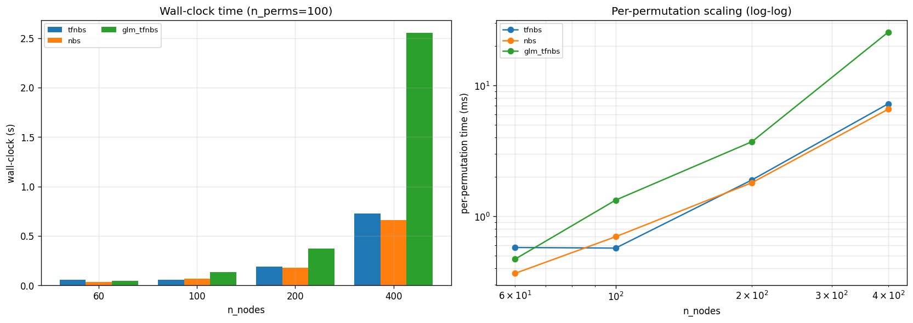

# ConnInfPy — Connectivity Inference in Python

[](https://github.com/IHB-IBR-department/ConnInfPy/actions/workflows/tests.yml)
[](https://ihb-ibr-department.github.io/ConnInfPy/)


**A unified Python framework for permutation-based statistical inference on brain connectivity networks (fMRI, EEG).**

Give ConnInfPy one connectivity matrix per subject and a design (two groups,
paired conditions, or a continuous predictor with confounds); it returns
FWER-corrected p-values for every edge, split by direction. One call to
`conninfpy.analyze()` covers input preparation, optional multi-site
harmonization, and permutation inference with any of nine methods.

- **Six topology-aware enhancement methods** — NBS-extent, NBS-intensity,
  TFNBS, cNBS, **NI-TFNBS** (network-informed soft block-density prior) and
  **FBC-TFNBS** (hard block prior with minimum cluster size) — plus three
  baselines (per-edge $t$, Bonferroni, BH-FDR), all on one permutation engine
  with the +1 Phipson–Smyth correction.
- **Edge-wise GLM with Freedman–Lane permutation** — continuous predictors,
  confounds, $t$/$\beta$/F contrasts, paired designs with condition-varying
  confounds, directional (positive/negative) FWER.
- **Multi-site data** — parametric empirical-Bayes ComBat (Johnson 2007;
  Fortin 2017/2018) in NumPy, site dummies, and site-blocked permutation.
- **GPD/gamma tail acceleration** — 200 permutations reproduce 5000-permutation
  empirical p-values within $|\Delta(-\log_{10}p)| \le 0.001$ on >99% of edges
  (≈25× faster), with a goodness-of-fit guard and empirical fallback.
- **JIT-compiled TFNBS** via `numba` (≈15× end-to-end on a 60×60, 200-permutation
  benchmark), with a SciPy fallback.
- **20-scenario topology library** of planted effects (hub, rich club, chain,
  gradient, …) for method benchmarking.


> **History.** Originally a TFNBS-only implementation (`tfnbs`); renamed and
> expanded in 2026-04 to the framework presented here. The old URL
> `https://github.com/IHB-IBR-department/TFNBS` redirects automatically.

---

## Installation

Python **3.12, 3.13 or 3.14**. Until the first PyPI release, install from a
clone:

```bash
git clone https://github.com/IHB-IBR-department/ConnInfPy.git
cd ConnInfPy
conda create -n conninfpy python=3.13 -y
conda activate conninfpy
python -m pip install -e .
```

After the release this becomes `python -m pip install conninfpy`. Optional
extras: `[app]` (Streamlit interface), `[decode]` (NiMARE meta-analytic
decoding), `[notebooks]` (Jupyter tutorials), `[dev]` (tests and docs).

If `numba` fails to install on your platform, install without it — ConnInfPy
falls back to SciPy automatically:

```bash
python -m pip install -e . --no-deps
python -m pip install numpy scipy statsmodels pandas matplotlib scikit-learn pyyaml threadpoolctl
```

---

## Quickstart

Simulate two groups with a planted difference, run TFNBS, and check the result
against the ground truth. `conninfpy.sim` builds modular networks with 20
effect topologies (hub, chain, rich club, …); here group 2 has stronger
connectivity inside one module. Needs only the core install; takes a few
seconds (the first run in a new environment adds ~30 s while numba compiles
and caches its kernels):

<!-- readme-quickstart -->
```python
import conninfpy

# Two groups of 30 subjects, 40 regions in 4 modules. Group 2 has stronger
# connectivity inside one module ("within_module_dense", one of 20 scenarios).
gen = conninfpy.sim.TopologyDatasetGenerator(n_nodes=40, n_modules=4, seed=0)
ds = gen.generate("within_module_dense", effect_size=0.3, n_samples=30, time_points=200)

out = conninfpy.analyze(
    group1=ds.group1, group2=ds.group2, input="r", test_type="two-sample",
    method="tfnbs", n_permutations=200, acceleration="gpd", rng=0,
)
print(out)

# Score the result against the planted effect
found = out["positive"] < 0.05
planted = ds.effect_mask != 0
print(f"planted edges found: {(found & planted).sum() // 2} of {planted.sum() // 2}")
print(f"false positives:     {(found & ~planted).sum() // 2}")
```

```text
AnalyzeResult(inference=InferenceResult(method='tfnbs', n_perms=200, accel=gpd, sig@α=0.05: pos=45, neg=0, wall_time=2.77s))
planted edges found: 45 of 45
false positives:     0
```

`out["positive"]` holds FWER-corrected p-values for `group2 > group1`
(`out["negative"]` for the reverse). `input="r"` says the matrices are
correlations, so Fisher r→z is applied once; with a unit diagonal `analyze()`
detects this itself, and data that could be either raise an error instead of
being guessed. `out.significant_edges(atlas)` turns the result into an edge
table — see [Results](#results).

### Real data

From a clone of the repository, the bundled ABIDE-mini dataset (204 subjects,
Schaefer-100, 5 sites) runs an age analysis with multi-site harmonization in a
few seconds:

<!-- readme-real-data -->
```python
import conninfpy

data = conninfpy.load("datasets/abide_mini.yaml")
pheno = data.pheno
out = conninfpy.analyze(
    data.data,                                     # correlations, detected automatically
    interest=pheno["Age"].to_numpy(float),
    confounds=pheno[["Sex", "Motion_FD"]].to_numpy(float),
    sites=pheno["site"].to_numpy(),                # ComBat + site dummies + site-blocked permutation
    method="tfnbs", n_permutations=200, acceleration="gpd", rng=0,
)
print(out)
print(out.significant_edges(conninfpy.AtlasInfo.schaefer_100_yeo7()))
```

Permutations run on all CPU cores by default (`use_mp=True`), in scripts and
notebooks alike — no `if __name__ == "__main__":` guard is needed.

Your own data can be any NumPy stack of shape `(n_subjects, N, N)`, or a small
YAML manifest read with `conninfpy.load()`; see
[`datasets/abide_mini.yaml`](datasets/abide_mini.yaml) for the schema.
Bundled loaders cover NumPy arrays, CSV/NIfTI/timeseries directories,
fMRIPrep derivatives and ABIDE.

### Command line

The same analysis without writing Python: an analysis file names the data
manifest, the design (phenotype columns) and the inference settings.

```bash
conninfpy run examples/configs/abide_mini_age.yaml   # writes edges.csv, pvals.npz, provenance.json
conninfpy info                                       # versions, TFNBS backend, cores
```

See [`examples/configs/abide_mini_age.yaml`](examples/configs/abide_mini_age.yaml)
for every option; designs are `glm`, `two-sample`, `paired` and `one-sample`.
`provenance.json` records the package version, the analysis file, the data
used and any warnings, so a result can be traced back to how it was made.

---

## Choosing the design

| Design | Call |
|---|---|
| Two groups | `analyze(group1=A, group2=B, test_type="two-sample")` |
| Two conditions, same subjects | `analyze(group1=A, group2=B, test_type="paired")` |
| … with a confound that differs between conditions (e.g. motion) | add `confounds_group1=fd_A, confounds_group2=fd_B` |
| One group vs zero | `analyze(group1=Y, test_type="one-sample")` |
| Continuous predictor + confounds | `analyze(Y, interest=age, confounds=np.column_stack([sex, fd]))` |
| Several predictors, one permutation pass | `analyze(Y, interest={"age": age, "sex": sex}, confounds=fd)` |
| Multi-site | add `sites=site` (default `harmonize="auto"`; see below) |
| Omnibus F-test, custom contrast | `conninfpy.stats.compute_p_val_glm(Y, design_matrix=X, contrast=C, stat_type="fstat")` |

**Direction.** `positive` is `group2 > group1` for group designs, and a
positive association with `interest` for the GLM.

**Multi-site.** With `sites=`, permutations are blocked by site. `harmonize=`
chooses how site effects are removed:
`"combat_site_dummies_glm"` (ComBat that preserves the confounds but never
sees the tested variable, then site dummies in the GLM — the default when
confounds are given), `"combat_only"`, or `"site_dummies_glm"` (no ComBat).
See the [workflows guide](https://IHB-IBR-department.github.io/ConnInfPy/workflows.html)
for when to use which.

## Inference methods

Pass `method=` to `analyze()` (or to the advanced pipelines):

| `method` | What it does | Extra arguments |
|---|---|---|
| `"tstat"` | Per-edge $t$, max-statistic FWER | — |
| `"tfnbs"` | Threshold-free network-based statistic | `e`, `h`, `n`, `start_thres` |
| `"nbs"` | Classical NBS with a fixed threshold | `threshold`, `nbs_stat` |
| `"cnbs"` | Constrained NBS (network-block aggregation) | `net_labels` |
| `"ni_tfnbs"` | Network-informed TFNBS (soft block prior) | `net_labels` |
| `"fbc_tfnbs"` | Functional-block-constrained TFNBS | `net_labels`, `min_cluster_size` |
| `"bonferroni"` / `"bh_fdr"` | Parametric baselines, no permutation | — |
| `"bh_fdr_perm"` | Permutation-calibrated BH-FDR | — |

Defaults are shared by every entry point (`conninfpy.defaults`):
1000 permutations with exact empirical p-values, TFNBS `e=0.3`, `h=3.0`.
For fast exploratory runs use `n_permutations=200, acceleration="gpd"`.

## Results

`analyze()` returns an `AnalyzeResult`:

```python
out["positive"], out["negative"]   # FWER-corrected p-values, (N, N)
out.inference                      # InferenceResult: statistics, metadata, exports
out.flags                          # plain-English notes on what analyze() decided
out.combat_diagnostics             # set when ComBat ran

out.significant_edges(atlas)       # sorted, atlas-annotated edge table (DataFrame)
out.to_csv("edges.csv", atlas=atlas)
out.inference.n_significant(0.05)  # {'positive': ..., 'negative': ...}

from conninfpy.plot import summary_figure
summary_figure(out.inference, atlas=atlas).savefig("summary.pdf")
```

`conninfpy.AtlasInfo` ships Schaefer-100/200/400 (Yeo-7) and Brainnetome-246;
`AtlasInfo.from_csv()` reads any other atlas. With the `decode` extra,
`out.inference.decoded_edges(atlas)` adds Neurosynth/NeuroQuery term
associations to the edge table.

## Advanced API

`analyze()` is built from public modules you can use directly:

| Module | Contents |
|---|---|
| `conninfpy.stats` | The permutation pipelines: `compute_p_val` (t-test designs), `compute_p_val_glm` (custom design matrix, t/β/F contrasts), `compute_p_val_glm_multi`, `compute_p_val_paired_glm`, `compute_null_dist`. Inputs on the analysis scale (e.g. Fisher z). |
| `conninfpy.enhance` | Enhancement without permutation: `apply_tfnbs`, `apply_nbs`, …, the raw `get_*_score` functions, and the BCT-style `nbs_bct` reference |
| `conninfpy.harmonize` | `combat_harmonize`, `combat_fit` / `combat_apply` (for train/test transfer), `design_diagnostics`, `compute_vif` |
| `conninfpy.acceleration` | GPD / gamma tail fits |
| `conninfpy.loaders` | Manifest-based loading (`load`, `ManifestLoader`) and the bundled loaders |
| `conninfpy.sim` | Synthetic connectivity with planted effects and the 20 topology scenarios |
| `conninfpy.plot`, `conninfpy.eeg_utils` | Figures; EEG data structures and helpers |

Worked examples for each are in the
[usage guide](https://IHB-IBR-department.github.io/ConnInfPy/usage.html).

---

## Interactive application

The optional Streamlit app provides manifest-based data loading, design
setup, background inference, directional result plots, atlas-aware edge
exports and NiMARE decoding:

```bash
python -m pip install -r requirements/gui.txt
streamlit run apps/streamlit_nimare.py
```

The repository-root `requirements.txt` is the public Streamlit Cloud profile
(Cloud only looks for dependency files next to the entry point or at the repo
root, so it mirrors `requirements/gui.txt` there). It excludes NiMARE, so the
public app labels decoding as available in the offline version; install
`requirements/gui-full.txt` for the complete local version.

**LLM-assisted interpretation (optional).** `conninfpy.interpret` turns
decoding output into a cautious methods-style summary via OpenAI, Google
Gemini or OpenRouter (keys read from a local `.env`; without a key it falls
back to a deterministic template). The app exposes it as its
"Interpretation" step.

## Performance



Wall-clock time for 100 permutations at increasing network sizes (left) and
the same per permutation on a log-log scale (right). NBS and TFNBS scale
similarly; GLM-TFNBS is slower because each permutation refits the edge-wise
model. Treat these as relative numbers: CPU, BLAS backend, multiprocessing,
acceleration and the permutation count all change absolute runtimes.

## Tutorials and examples

| Path | What |
|---|---|
| [examples/notebooks/](examples/notebooks/) | Tutorial series: quickstart, enhancement methods, GLM, acceleration, parameter sweeps, topology gallery, EEG, results export, and ABIDE |
| [examples/benchmarks/](examples/benchmarks/) | Timing / GLM / acceleration benchmarks and external validation (PALM, scipy, statsmodels, nilearn) |
| [examples/simulation_validation/](examples/simulation_validation/) | Simulation validation (FPR + power) backing the validation paper |
| [examples/abide_validation/](examples/abide_validation/) | Real-data validation on ABIDE (age, diagnosis, motion, within-site replication) |
| [examples/openclose_validation/](examples/openclose_validation/) | Open-Close bidirectional ML transfer (IHB ↔ China) |

## Documentation

Full reference at [IHB-IBR-department.github.io/ConnInfPy](https://IHB-IBR-department.github.io/ConnInfPy/).
The docs auto-build on push to `main`. Contributor setup, tests and the
release process are in [CONTRIBUTE.md](CONTRIBUTE.md).

## Citing the toolbox

To cite the toolbox: [doi]() and refer to the paper [paper_doi]()

```
[doi]
```

For further discussions or to report bugs, please contact [knyazeva@ihb.spb.ru](mailto:knyazeva@ihb.spb.ru) or open an issue at https://github.com/IHB-IBR-department/ConnInfPy/issues.

## Acknowledgements

Parts of this codebase were developed with the assistance of
[Claude Code](https://claude.com/claude-code) (Anthropic).
