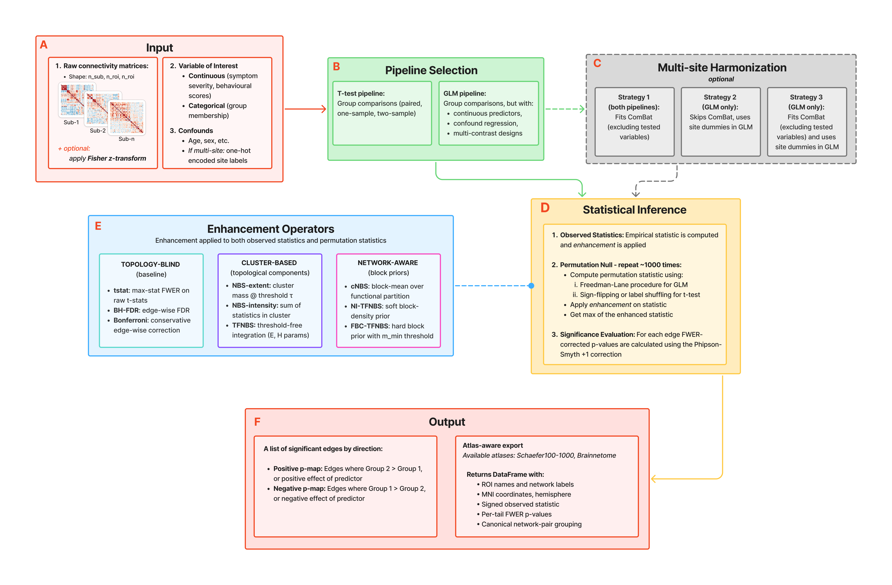

# ConnInfPy — Connectivity Inference in Python

[](https://github.com/IHB-IBR-department/ConnInfPy/actions/workflows/tests.yml)
[](https://ihb-ibr-department.github.io/ConnInfPy/)


**A unified Python framework for permutation-based statistical inference on brain connectivity networks (fMRI).**

Give ConnInfPy one connectivity matrix per subject (or BOLD time series via
`compute_connectivity()`) and a design (two groups, paired conditions,
Group × Condition, or continuous/categorical predictors with confounds and
interactions): **one design → multiple network inference operators → honest
inference unit → anatomical interpretation without adding new statistical tests.**
It returns corrected p-values split by direction — empirical permutation
p-values for the max-statistic methods (`tfnbs`, `ni_tfnbs`, `fbc_tfnbs`, `nbs`,
`tstat`: FWER under the premises on the [approach page](https://IHB-IBR-department.github.io/ConnInfPy/approach.html)),
`cnbs` (FWER across blocks or FDR, by its correction mode), `bh_fdr_perm` (FDR),
and parametric p-values for `bonferroni` (FWER) and `bh_fdr` (FDR) — each read
at its inference unit (edge, component or block). `ni_tfnbs` and `fbc_tfnbs`
are prespecified options when an *a priori* network partition is justified, not
post-hoc replacements for `tfnbs`. One call to `conninfpy.analyze()` covers
input preparation, optional multi-site harmonization, and inference with any of
nine methods, alongside three reviewer-ready diagnostic layers (pre-inference
QC–FC motion check, leave-one-out subject influence, and `network_summary` /
`node_summary` / `component_table` alongside edges).

- **Six topology-aware enhancement methods** — NBS-extent, NBS-intensity,
  TFNBS, cNBS, **NI-TFNBS** (network-informed soft block-density prior) and
  **FBC-TFNBS** (hard block prior with minimum cluster size) — plus the
  baselines: per-edge $t$ (`tstat`) on the same permutation engine as the
  enhancement methods (empirical p-values with the +1 Phipson–Smyth
  correction), permutation-calibrated BH-FDR (`bh_fdr_perm`) as a separate
  path, and the parametric Bonferroni and BH-FDR baselines, which use no
  permutations.
- **Edge-wise GLM with Freedman–Lane permutation** — continuous predictors,
  confounds, $t$/$\beta$/F contrasts, paired designs with condition-varying
  confounds, directional (positive/negative) FWER from the max-statistic null
  for `tstat` and the TFNBS family (Freedman–Lane permutation, hence
  approximate; see the
  [approach page](https://IHB-IBR-department.github.io/ConnInfPy/approach.html));
  `cnbs` and the BH variants as above.
- **Multi-site data** — parametric empirical-Bayes ComBat (Johnson 2007;
  Fortin 2017/2018) in NumPy, site dummies, and site-blocked permutation.
- **GPD/gamma tail acceleration (opt-in, off by default)** — for
  exploratory runs with a few hundred permutations, `acceleration="gpd"` (or
  `"gamma"`) replaces the p-values that fewer than 10 permutations reach with a
  fitted-tail estimate; every other p-value stays the empirical permutation
  p-value (for the GPD the replacement applies only to units at or above the
  fitted threshold whose fit passes the Anderson–Darling check; the gamma
  branch has no such check). The replaced values are model-based and
data-dependent: no binomial
  interval is reported for them, they can be *larger* than the empirical
  p-value they replace, and no
  FWER or power calibration is claimed for them. Reported results use the
  empirical default; the known limits are listed on the
  [approach page](https://IHB-IBR-department.github.io/ConnInfPy/approach.html).
- **JIT-compiled TFNBS and NBS** via `numba`; both scoring paths also run
  without it (see [Installation](#installation)).
- **20-scenario topology library** of planted effects (hub, rich club, chain,
  gradient, …) for method benchmarking.
- **Diagnostics that add no test** — descriptive motion / QC–FC side-car
  statistics (`analyze(..., motion_qc=...)`: the per-edge Spearman correlation
  between edge values and framewise displacement, and — when ROI coordinates
  are known — how those per-edge associations relate to edge length; no
  p-values, computed on the native input before inference), leave-one-out subject
  influence on caller-chosen edges (`conninfpy.influence.subject_influence`:
  how much each subject moves the native effect and statistic, nothing is
  re-tested), connectivity estimation from time series with shrinkage
  diagnostics (`conninfpy.compute_connectivity`), and result tables that keep
  the inference unit (`component_table`, `node_summary`, `network_summary`).
- **Anatomical interpretation with the Brainnetome atlas (BNA-246)** — each
  ROI is described by the Brainnetome tissue its sphere or parcel covers
  (subregion → gyrus → lobe, `mixed` below the purity threshold), each
  connection by its hemispheric relation, circuit class, distance and
  population structural connectivity, with BrainMap literature context.
  Descriptive: the p-values and the inference unit are unchanged.



> **History.** Originally a TFNBS-only implementation (`tfnbs`); renamed and
> expanded in 2026-04 to the framework presented here. The old URL
> `https://github.com/IHB-IBR-department/TFNBS` redirects automatically.

---

## Installation

Python **3.12, 3.13 or 3.14** (`>=3.12,<3.15` is required). On systems that default to Python 3.10 or 3.11 (such as Ubuntu 22.04 LTS or older `conda` base environments), create an explicit Python 3.12/3.13 environment via `uv venv --python 3.13` or `conda create -n conninfpy python=3.13`.

> **Shared / read-only HPC environments.** If `site-packages` is read-only on a cluster, set a writable Numba cache directory before running ConnInfPy: `export NUMBA_CACHE_DIR=/tmp/numba_cache` (or a writable scratch directory).

### Recommended: `uv` (fast, zero-conflict setup)

[`uv`](https://docs.astral.sh/uv/) manages Python 3.12–3.14 and resolves dependencies directly without `conda` + `pip` conflicts:

```bash
# Editable install from a local clone
git clone https://github.com/IHB-IBR-department/ConnInfPy.git
cd ConnInfPy
uv venv --python 3.13
uv pip install -e .

# Or install a built wheel directly / run the CLI + Streamlit app isolated
uv pip install conninfpy-2.0-py3-none-any.whl
uv tool install "conninfpy[app]"
uvx conninfpy info
```

### Standard `conda` / `pip`

```bash
git clone https://github.com/IHB-IBR-department/ConnInfPy.git
cd ConnInfPy
conda create -n conninfpy python=3.13 -y
conda activate conninfpy
python -m pip install -e .
```

After PyPI publication this becomes `uv pip install conninfpy` or
`python -m pip install conninfpy`. Optional extras: `[app]` (Streamlit
interface), `[notebooks]` (Jupyter tutorials), `[dev]` (tests and docs).

A built artifact installs the same way and is self-contained once installed:
`python -m build` writes `dist/conninfpy-2.0-py3-none-any.whl` and
`dist/conninfpy-2.0.tar.gz`, and
`python -m pip install dist/conninfpy-2.0-py3-none-any.whl` (or the
`.tar.gz`) resolves the dependencies, installs the bundled Brainnetome + SUIT
atlas data, packages the Streamlit app, and puts the `conninfpy` command on
the path of that environment — no checkout needed afterwards.

Without `numba`, install the other dependencies yourself. Which code runs then
depends on the method and scoring path: exact TFNBS (`n=None`) executes its
pure-Python graph and block sweeps, exact NI-TFNBS / FBC-TFNBS use vectorized
NumPy, and the legacy threshold grid (an explicit `n`) plus NBS use their SciPy
implementations. The active fallback backend is logged once per call, e.g.
`Numba is not installed; TFNBS (exact) is running on the 'python' fallback backend.`
The permutations, the
correction and the significance level are not affected by this choice; the
runtime of the uncompiled paths is not benchmarked here. `conninfpy info`
reports whether `numba` was found:

```bash
python -m pip install -e . --no-deps
python -m pip install numpy scipy statsmodels pandas matplotlib scikit-learn joblib threadpoolctl pyyaml "nibabel>=3.2"
```

`nibabel` is not optional: the atlas and the interpretation step read their
label images with it, so the annotation fails without it even though the
statistics still run.

---

## Quickstart

Simulate two groups with a planted difference, run TFNBS, and check the result
against the ground truth. `conninfpy.sim` builds modular networks with 20
effect topologies (hub, chain, rich club, …); here group 2 has stronger
connectivity inside one module. Needs only the core install; takes a few
seconds (the first run in a new environment adds some time while numba
compiles and caches its kernels):

<!-- readme-quickstart -->
```python
import conninfpy

# Two groups of 30 subjects, 40 regions in 4 modules. Group 2 has stronger
# connectivity inside one module ("within_module_dense", one of 20 scenarios).
gen = conninfpy.sim.TopologyDatasetGenerator(n_nodes=40, n_modules=4, seed=0)
ds = gen.generate("within_module_dense", effect_size=0.3, n_samples=30, time_points=200)

out = conninfpy.analyze(
    group1=ds.group1, group2=ds.group2, input="r", test_type="two-sample",
    method="tfnbs", n_permutations=1000, rng=0,   # exact TFNBS integration, empirical permutation p-values (the defaults)
)
print(out)

# Score the result against the planted effect
found = out["positive"] < 0.05
planted = ds.effect_mask != 0
print(f"planted edges found: {(found & planted).sum() // 2} of {planted.sum() // 2}")
print(f"false positives:     {(found & ~planted).sum() // 2}")
```

```text
AnalyzeResult(inference=InferenceResult(method='tfnbs', n_perms=1000, accel=empirical, sig@α=0.05: pos=45, neg=0, wall_time=5.50s))
planted edges found: 45 of 45
false positives:     0
```

`out["positive"]` holds the TFNBS p-values for `group2 > group1` —
FWER-corrected at the edge unit under the validity of the permutation scheme
(`out["negative"]` for the reverse). `input="r"` says the matrices are
correlations, so Fisher r→z is applied once; with a unit diagonal `analyze()`
detects this itself, and data that could be either raise an error instead of
being guessed. `out.significant_edges(atlas)` turns the result into an edge
table — see [Results](#results).

### Real data

From a clone of the repository, the bundled ABIDE-mini dataset (204 subjects,
Schaefer-100, 5 sites; one subject with a region without signal is dropped on
loading, as its manifest specifies) runs an age analysis with multi-site
harmonization and 1,000 permutations:

<!-- readme-real-data -->
```python
import conninfpy

data = conninfpy.load("datasets/abide_mini.yaml")
pheno = data.pheno
out = conninfpy.analyze(
    data.data,                                     # correlations, detected automatically
    interest=pheno["Age"].to_numpy(float),
    confounds=pheno[["Sex", "Motion_FD"]].to_numpy(float),
    sites=pheno["site"].to_numpy(),                # ComBat + site dummies + site-blocked permutation
    method="tfnbs", n_permutations=1000, rng=0,
)
print(out)
print(out.significant_edges(conninfpy.AtlasInfo.schaefer_100_yeo7()))
```

Permutations run on all CPU cores by default (`use_mp=True`), in scripts and
notebooks alike — no `if __name__ == "__main__":` guard is needed.

Your own data can be any NumPy stack of shape `(n_subjects, N, N)`, or a small
YAML manifest read with `conninfpy.load()`; see
[`datasets/abide_mini.yaml`](datasets/abide_mini.yaml) for the schema.
Bundled loaders cover NumPy arrays, CSV/NIfTI/timeseries directories,
fMRIPrep derivatives and ABIDE.

### Command line

The full workflow without writing Python — generate a config from a manifest,
run pre-inference design & motion QC, execute permutation inference, and export
tables/annotations/figures:

```bash
conninfpy init --manifest datasets/abide_mini.yaml --out analysis.yaml
conninfpy qc analysis.yaml --motion-qc                # alias: conninfpy check
conninfpy run examples/abide/configs/abide_mini_age.yaml   # writes edges.csv, pvals.npz, bundle.pkl, provenance.json
conninfpy interpret conninfpy_results --cerebellum anatom  # node/network summaries, BNA+SUIT annotation, plots
conninfpy app                                         # launch Streamlit workspace (requires [app])
conninfpy info                                        # versions, TFNBS backend, cores
```

See [`examples/abide/configs/abide_mini_age.yaml`](examples/abide/configs/abide_mini_age.yaml)
for every option; designs are `glm`, `two-sample`, `paired` (including `Group × Condition`
and `interactions`) and `one-sample`. `provenance.json` records the package version,
the analysis file, the data used and any warnings, so a result can be traced back
to how it was made.

---

## Choosing the design

| Design | Call |
|---|---|
| Two groups | `analyze(group1=A, group2=B, test_type="two-sample")` |
| Two conditions, same subjects | `analyze(group1=A, group2=B, test_type="paired")` |
| … with a confound that differs between conditions (e.g. motion) | add `confounds_group1=fd_A, confounds_group2=fd_B` |
| One group vs zero | `analyze(group1=Y, test_type="one-sample")` |
| Continuous predictor + confounds | `analyze(Y, interest=age, confounds=np.column_stack([sex, fd]))` |
| Several predictors, one permutation pass | `analyze(Y, interest={"age": age, "sex": sex}, confounds=fd)` |
| Multi-site | add `sites=site` (default `harmonize="auto"`; see below) |
| Omnibus F-test, custom contrast | `conninfpy.stats.compute_p_val_glm(Y, design_matrix=X, contrast=C, stat_type="fstat")` |

**Direction.** `positive` is `group2 > group1` for group designs, and a
positive association with `interest` for the GLM.

**Multi-site.** With `sites=`, permutations are blocked by site. `harmonize=`
chooses how site effects are removed:
`"combat_site_dummies_glm"` (ComBat that preserves the confounds but never
sees the tested variable, then site dummies in the GLM — the default when
confounds are given), `"combat_only"`, or `"site_dummies_glm"` (no ComBat).
See the [workflows guide](https://IHB-IBR-department.github.io/ConnInfPy/workflows.html)
for when to use which.

## Inference methods

Pass `method=` to `analyze()` (or to the advanced pipelines):

| `method` | What it does | Extra arguments |
|---|---|---|
| `"tstat"` | Per-edge $t$, max-statistic FWER | — |
| `"tfnbs"` | Threshold-free network-based statistic | `e`, `h`, `n`, `start_thres` |
| `"nbs"` | Classical NBS with a fixed threshold | `threshold`, `nbs_stat` |
| `"cnbs"` | Constrained NBS (Noble & Scheinost, 2020): mean signed t per network block, a null per block, Bonferroni or BH across blocks; inference per block | `net_labels` |
| `"ni_tfnbs"` | Network-informed TFNBS (soft block prior) | `net_labels` |
| `"fbc_tfnbs"` | Functional-block-constrained TFNBS | `net_labels`, `min_cluster_size` |
| `"bonferroni"` / `"bh_fdr"` | Parametric baselines, no permutation | — |
| `"bh_fdr_perm"` | Permutation-calibrated BH-FDR | — |

Shared numerical defaults (`conninfpy.defaults`):
1000 permutations with empirical permutation p-values (`acceleration=None`), exact
TFNBS integration (`n=None`) with `e=0.4`, `h=3.0`, `start_thres=1.65`
(asymptotic normal reference; NBS `threshold=2.0`, `nbs_stat="extent"`;
FBC-TFNBS `min_cluster_size=3`). `analyze()` uses a single two-sided family
(`two_tailed=True`) by default, while the low-level `compute_p_val*`
functions retain `two_tailed=False` for backwards compatibility.
For exploratory runs, `n_permutations=200, acceleration="gpd"` opts into the
fitted-tail replacement described above; it is not a setting for reported
results.

## Results

`analyze()` returns an `AnalyzeResult`:

```python
out["positive"], out["negative"]   # corrected p-values, (N, N): FWER (max-statistic, bonferroni) or FDR (BH) by method
out.inference                      # InferenceResult: statistics, metadata, exports
out.flags                          # plain-English notes on what analyze() decided
out.combat_diagnostics             # set when ComBat ran

out.significant_edges(atlas)       # sorted, atlas-annotated edge table (DataFrame)
out.network_summary(atlas)         # one row per network pair: counts, proportions, -log10 p mass
out.component_table(atlas)         # nbs: one row per observed component with its component-level p-value
out.node_summary(atlas)            # one row per ROI: which ROIs gather the detections (descriptive)
out.to_csv("edges.csv", atlas=atlas)
out.inference.n_significant(0.05)  # {'positive': ..., 'negative': ...}

from conninfpy.plot import summary_figure
summary_figure(out.inference, atlas=atlas).savefig("summary.pdf")
```

**Inference unit.** The corrected p-values belong to a unit, recorded as
`out.inference.inference_unit`: the edge for `tstat`, the TFNBS family and the
BH-FDR variants, the component for `nbs`, the block for `cnbs`. Every edge of
a significant component or block carries its p-value; that is a claim about
the set, not about each edge. `component_table` and `node_summary` keep that
unit and add no test.

**Network-level summaries.** Specific edges often replicate poorly across
cohorts while network-pair patterns are much more stable, so report both.
`out.network_summary(atlas)` aggregates the result over pairs of networks
taken from the atlas's per-region `networks` labels — any partition you
define: the number of possible edges, significant edges and their proportion
per direction, a signed proportion, and the summed / mean −log₁₀ p.
`as_matrix="sum_neglog10p_positive"` (or any other column) returns a K × K
table; `conninfpy.plot.plot_network_summary` draws the signed proportion.

`conninfpy.AtlasInfo` ships Schaefer-100/200/400 (Yeo-7) and Brainnetome-246;
`AtlasInfo.from_csv()` reads any other atlas. `AtlasInfo.bna_246()` groups its
regions by the Brainnetome Yeo-7 division (`bna246_hierarchy.csv`; subcortical
regions are `Subcortical`); pass `networks="yeo17"` or `networks="lobe"` for
the other groupings. **Changed in October 2026:** it previously grouped by
lobe, so network-pair summaries, the network columns of edge tables (including
the CLI's `edges.csv` with `atlas: bna_246`) and network-ordered figures of
BNA-246 data now follow Yeo-7; use `networks="lobe"` for the old grouping.

**Anatomical interpretation (Brainnetome).** `conninfpy.interpret` describes
ROIs and detected connections with the Brainnetome atlas (BNA-246, Fan et al.
2016):

```python
from conninfpy.interpret import annotate_bna_regions, annotate_rois, interpret_result

rois = annotate_rois(coords, names=names, support="sphere", radius_mm=6,
                     space="MNI152NLin2009cAsym")   # or support="parcel"; networks=own labels
# rois = annotate_bna_regions(bna_ids)            # data parcellated with the Brainnetome atlas itself
report = interpret_result(out.inference, rois, name="age")
report.save("results/age")                         # tables, evidence packet, connectograms
```

Network labels follow the atlas: Schaefer parcels keep their Yeo-7 labels
(`networks=`), Brainnetome regions take the Brainnetome division
(`bna246_hierarchy.csv`).

Each ROI is described by the tissue it sampled (overlap of its sphere or
parcel with BNA regions; a hard label only at the finest level holding at
least half of it, otherwise "mixed"), with its gyrus, lobe, hemisphere,
cytoarchitectonic description, Yeo network and BrainMap behavioural domains.
The atlas is on the FSL MNI152 grid, which `space=` assumes by default
(no flag); declare the template the signals were extracted in
(`"MNI152NLin2009cAsym"` for fMRIPrep, `"MNI152"` when the variant is
unknown), and other MNI variants are flagged approximate.
Each connection gets its hemispheric relation (homotopic or not), circuit
class (cortico-cortical, thalamo-cortical, ...), distance, sphere overlap and
population structural connectivity. Connectograms
(`conninfpy.plot.plot_connectogram`; also in the app's annotation view) draw
one tail over the Brainnetome units and report atlas coverage: ROIs without
atlas support (outside the atlas or below `min_coverage`) are not placed, and
the footer — like `aggregate_connections(...).attrs["coverage"]` — states how
many were left out and how many detected connections touch them. BrainMap
terms are published
forward-inference associations (which tasks activate a region), not functions
of a region or a connection, and the summaries are descriptive: they put the
detections next to the tested opportunities and add no test. The optional
probabilistic and tractography maps (`BNA_PM_4D.nii.gz`,
`BNA_SC_3D_246.zip` from atlas.brainnetome.org) are read from
`~/conninfpy_data/brainnetome/` by default. Set `$CONNINFPY_DATA` to a data root
(the maps go in its `brainnetome/` subfolder), use `$CONNINFPY_BNA_DIR` for a
direct legacy override, or pass `data_dir=`. Originals are checked against the
bundled SHA256 manifest; they are never downloaded implicitly. Source tables
for rebuilding live in `brainnetome/sources/`; derived arrays remain in
`~/.cache/conninfpy/bna246/` (or `$CONNINFPY_CACHE/bna246/`). See
[atlas resource ownership](docs/source/architecture.rst). Brainnetome data are for
non-commercial use with attribution and share-alike (see
`conninfpy/atlas_data/NOTICE_BRAINNETOME.txt`); the MIT licence covers the
code only.

The package also bundles the DiedrichsenLab cerebellar atlases v1.2 as data
resources: label tables and NIfTI maps for `atl-Anatom` (Diedrichsen 2009),
`atl-Buckner7` / `atl-Buckner17` (Buckner 2011) and `atl-NettekovenSym32`
(Nettekoven 2024). Their voxel grids lie on the same 1 mm lattice as the
Brainnetome map (integer-lattice coincidence, no resampling), and the upstream
release notes declare the collection CC-BY. Opt-in runtime integration is
available in `conninfpy.interpret` and `conninfpy.plot.plot_connectogram()` via
`BrainnetomeReference.load(..., resolution_mm=1, cerebellum="anatom")` (or
`"buckner7"`, `"buckner17"`, `"nettekoven"`, or `conninfpy interpret --cerebellum anatom`),
which resolves ROIs outside BNA-246 into cerebellar parcels, assigns
`cerebello-*` circuit classes and crossed/ipsilateral lateralization, and adds
cerebellar sectors to connectograms. Sources, SHA256 hashes, per-file licence
notes and measured overlap facts are recorded in
`conninfpy/atlas_data/cerebellar_atlases_provenance.json` (template identity
itself was not independently verified). `AtlasInfo` and `analyze()` do not
auto-attach cerebellar atlases yet, and structural connectivity / BrainMap
profiles remain cortex/subcortex BNA-246 only.

## Advanced API

`analyze()` is built from public modules you can use directly:

| Module | Contents |
|---|---|
| `conninfpy.stats` | The permutation pipelines: `compute_p_val` (t-test designs), `compute_p_val_glm` (custom design matrix, t/β/F contrasts), `compute_p_val_glm_multi`, `compute_p_val_paired_glm`, `compute_null_dist`. Inputs on the analysis scale (e.g. Fisher z). |
| `conninfpy.enhance` | Enhancement without permutation: `apply_tfnbs`, `apply_nbs`, …, the raw `get_*_score` functions, and the BCT-style `nbs_bct` reference |
| `conninfpy.harmonize` | `combat_harmonize`, `combat_fit` / `combat_apply` (for train/test transfer), `design_diagnostics`, `compute_vif` |
| `conninfpy.acceleration` | GPD / gamma tail fits (opt-in; see the approach page for their limits) |
| `conninfpy.connectivity` | `compute_connectivity`: correlation / partial correlation from time series, with shrinkage and valid-frame diagnostics |
| `conninfpy.influence` | `subject_influence`: descriptive leave-one-out influence of each subject on caller-chosen edges of a finished result |
| `conninfpy.interpret` | Brainnetome annotation (`annotate_rois`, `interpret_result`) and the descriptive motion / QC–FC diagnostics (`motion_qc_fc`, `motion_qc_fc_paired`) |
| `conninfpy.loaders` | Manifest-based loading (`load`, `ManifestLoader`) and the bundled loaders |
| `conninfpy.sim` | Synthetic connectivity with planted effects and the 20 topology scenarios |
| `conninfpy.plot` | Figures: `summary_figure`, `plot_network_summary`, `plot_connectogram` and the descriptive `plot_coupling_classes` matrix |

Worked examples for each are in the
[usage guide](https://IHB-IBR-department.github.io/ConnInfPy/usage.html).

---

## Interactive application

The optional Streamlit app provides manifest-based data loading, design
setup, background inference, directional result plots, atlas-aware edge
exports and Brainnetome annotation:

```bash
uv pip install "conninfpy[app]"   # or: python -m pip install -r requirements/gui.txt
conninfpy app                     # or from a clone: streamlit run apps/streamlit_app.py
```

The repository-root `requirements.txt` is the public Streamlit Cloud profile
(Cloud only looks for dependency files next to the entry point or at the repo
root, so it mirrors `requirements/gui.txt` there).

**Local interpretation.** `conninfpy.interpret` turns the Brainnetome
annotation of the detected connections into descriptive tables, an evidence
packet and Brainnetome-style connectograms, entirely offline. The app exposes
it as its "Brainnetome Annotation" step.

## Performance


Wall-clock time for 100 permutations at increasing network sizes (left) and
the same per permutation on a log-log scale (right). NBS and TFNBS scale
similarly; GLM-TFNBS is slower because each permutation refits the edge-wise
model. Treat these as relative numbers: CPU, BLAS backend, multiprocessing,
acceleration and the permutation count all change absolute runtimes.

## Out of scope and custom atlases

ConnInfPy focuses on group-level statistical inference and anatomical reporting
on fMRI functional connectivity matrices. The following sit intentionally
outside the package scope:

- **fMRI preprocessing** (slice timing, motion correction, registration, denoising): use [fMRIPrep](https://fmriprep.org/) + `conninfpy.loaders.FmriprepDerivativesLoader` + `conninfpy.compute_connectivity()`.
- **Graph-theory metrics** (degree, global/local efficiency, modularity, clustering) and their group comparisons: use [`bctpy`](https://github.com/aestrivex/bctpy) alongside ConnInfPy.
- **Dynamic, effective, or directed connectivity**, and **task-fMRI gPPI / beta-series connectivity**: for task-modulated connectivity, see [TMFC](https://github.com/IHB-IBR-department/TMFC_denoise) / TMFCpy.
- **Unbalanced or mixed $\ge 3$-timepoint longitudinal models** (`Group × Time` across 3+ waves): currently only balanced within-subject omnibus F-contrasts (`D1`) are supported.
- **Third-party parcellations** (e.g., Seitzman-300, Power-264, AAL3, Glasser MMP): load any ROI table or 3D/4D label volume with `AtlasInfo.from_csv(path)` or `AtlasInfo.from_nifti(nii_path, labels=...)`.

## Tutorials and examples

| Path | What |
|---|---|
| [examples/notebooks/](examples/notebooks/) | Tutorial series (01–12): quickstart, enhancement methods, GLM, acceleration, parameter sweeps, topology gallery, results export, ABIDE, and v2.0 feature walkthrough |
| [examples/benchmarks/](examples/benchmarks/) | Timing / GLM / acceleration benchmarks and external validation (PALM, scipy, statsmodels, nilearn) |
| [examples/simulations/](examples/simulations/) | Simulation validation (FPR + power) backing the validation paper |
| [examples/abide/](examples/abide/) | Real-data validation on ABIDE (age, diagnosis, motion, within-site replication), CLI analysis files (`configs/`) and the Brainnetome interpretation |
| [examples/open_close/](examples/open_close/) | Open-Close (eyes closed vs open; IHB and Beijing): paired validation, bidirectional ML transfer (IHB ↔ China), the Brainnetome interpretation, and the experiments `atlas_stability/` (Schaefer vs native Brainnetome), `structural_prior/` (structural connectivity as an edge mask and as NI-TFNBS blocks) and `feature_stability/` (edge-only EO/EC models: post-fit feature importance and overlap at edge/anatomical/functional levels, with/without training-only ComBat) |

## Documentation

Full reference at [IHB-IBR-department.github.io/ConnInfPy](https://IHB-IBR-department.github.io/ConnInfPy/).
The docs auto-build on push to `main`. Contributor setup, tests and the
release process are in [CONTRIBUTE.md](CONTRIBUTE.md).
The [package organization guide](docs/source/architecture.rst) maps the
statistics, enhancement, atlas, interpretation, harmonization, simulation and
plotting packages, including legacy import compatibility and atlas-data access.

## Citing the toolbox

Cite the package with the metadata in [`CITATION.cff`](CITATION.cff) (version
2.0, MIT licence). No DOI has been registered for the package yet and the
software paper is in preparation; this section will be updated when a DOI is
assigned — until then please cite the repository and the version.

For further discussions or to report bugs, please contact [knyazeva@ihb.spb.ru](mailto:knyazeva@ihb.spb.ru) or open an issue at https://github.com/IHB-IBR-department/ConnInfPy/issues.
